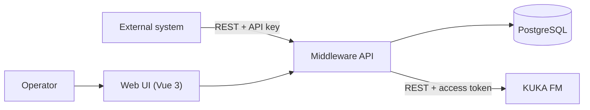

# KUKA FM Middleware

School project for the ITS course (FEI STU): a middleware between an external system (a fictional ERP/WMS) and **KUKA AMR Fleet Manager** (KUKA FM).

## Main idea

KUKA FM controls autonomous mobile robots, but it runs on its own. Operators have to dispatch and watch missions directly in its UI, and other systems have no way to talk to it.

The middleware sits between them and gives one simple, unified access point:

- **Dispatch missions.** It sends a new mission to KUKA FM (`submitMission`).
- **Cancel missions.** It stops a running mission (`cancelMission`).
- **Track missions and robots.** Background jobs poll KUKA FM and store mission states, with their full history, and robot states in PostgreSQL.
- **Protected REST API.** Every client has its own API key, and every user operation is written to an audit log.
- **Web UI.** Operators get a missions list, a mission detail with a status timeline, a dispatch form, a cancel dialog and a robots overview, all refreshed continuously.



## Technology

| Part | Technology |
|---|---|
| Backend | ASP.NET Core minimal API (C#, .NET LTS), Entity Framework Core |
| Database | PostgreSQL |
| Frontend | Vue 3, Vite, TypeScript, served by nginx |
| Runtime | Docker Compose (web, api, postgres) |
| CI/CD | Azure DevOps Pipelines |

## Project structure

```
kuka-middleware/
├── README.md               # this file
├── CLAUDE.md               # how to work: agents, workflow, rules, conventions, commands
├── implementation.md       # roadmap: phases done and planned
├── history/                # one note per finished phase / PR: what changed and why
├── .claude/
│   ├── system-definition.md   # what to build: binding spec (English)
│   ├── agents/                # planner, backend-expert, frontend-expert, ops-infra-expert, reviewer
│   ├── skills/                # Vue, Impeccable, GSAP, transitions, … (sources in skills-manifest.json)
│   └── settings.json          # shared Claude Code settings and Impeccable hooks
├── backend/                # ASP.NET Core API (src/) and unit tests (tests/)
├── frontend/               # Vue 3 web UI
├── docker/                 # Dockerfiles, nginx, docker-compose
├── ci-cd/                  # Azure DevOps pipelines
└── documentation/          # specification (Slovak): wiki, backlog, diagrams, mockups
```

`backend/`, `frontend/`, `docker/` and `ci-cd/` are still empty. They are filled from phase 4 on.

## Documentation

| Document | Contents |
|---|---|
| [documentation/wiki.md](documentation/wiki.md) | Goals, requirements FR1–FR7 / NFR1–NFR5, use cases UC1–UC7, activity diagrams, ERD, view mockups, acceptance criteria |
| [documentation/backlog.md](documentation/backlog.md) | Epic → 4 Features → 12 User Stories → 38 Tasks with acceptance criteria and estimates ([CSV for Azure Boards](documentation/backlog.csv)) |
| [.claude/system-definition.md](.claude/system-definition.md) | English spec for the agents, including open questions (§14) |

## How it is built

The project is built with Claude Code agents. Every phase goes through the same steps:

1. The **planner** maps the backlog acceptance criteria to steps and agents.
2. You approve the plan.
3. The **expert agents** (backend, frontend, ops-infra) implement it, each in its own folder.
4. Build and tests are run.
5. The **reviewer** checks every acceptance criterion and sends findings back to the agent that owns them.
6. A **history note** records what changed and why.
7. The work is merged through a PR.

The full rules are in [CLAUDE.md](CLAUDE.md), and the phases and their status are in [implementation.md](implementation.md).

## Getting started

To run the app on your PC, follow [LOCAL-DEVELOPMENT.md](LOCAL-DEVELOPMENT.md). It covers the prerequisites, running the app with Docker Compose, logs and the database, the tests and troubleshooting. All build and test commands are also in [CLAUDE.md → Commands](CLAUDE.md#commands).

After cloning, set your git identity for this repository:

```bash
git config user.name "Your Name"
```

```bash
git config user.email "you@example.com"
```

Set your identity per repository. The agent skills are committed in `.claude/skills/`, so they work right after the clone.
