# ITS – Middleware pre KUKA AMR Fleet Manager

  

> Zdroj: *ITS - Overview* (Azure DevOps wiki, posledná úprava 21. 10. 2026, aktualizované 26. 11. 2026). Tento dokument rozpracúva zadanie bod po bode, diagramy sú vo formáte SVG.
>
> Sekcie 1–8 opisujú požiadavky, návrh a realizované toky. Poznámky **Realizácia** odkazujú na podrobnosti v sekcii **9. Realizácia a stav implementácie**.

  

**Stav rozpracovania** (aktualizované 26. 11. 2026)

  

| Sekcia | Stav |
|---|---|
| 1. Ciele a stav | prepísané |
| 2. Požiadavky | prepísané |
| 3. Prípady použitia | hotové |
| 4. Diagramy aktivít | hotové, diagramy podľa realizácie |
| 5. Dátový model (ERD) | hotové, doplnené mapovanie stavov KUKA FM |
| 6. Návrh view aplikácie | hotové, doplnené rozdiely oproti mockupom |
| 7. Technológie | prepísané, doplnené verzie |
| 8. Akceptačné kritériá | vyhodnotené |
| 9. Realizácia a stav implementácie | hotové (stav k 26. 11. 2026) |

  

---

  

## 1. Ciele a stav

  

- **Východiskový stav:** KUKA AMR Fleet Manager (KUKA FM) bežal samostatne, bez napojenia na ERP, PLM či WMS. Obsluha zadávala a sledovala misie priamo v jeho UI.

- **Cieľový stav:** middleware sprostredkúva riadenie a sledovanie misií pre iný (fiktívny) systém — zjednodušuje a zjednocuje prístup k funkciám KUKA FM cez vlastné REST rozhranie a webové UI.

  

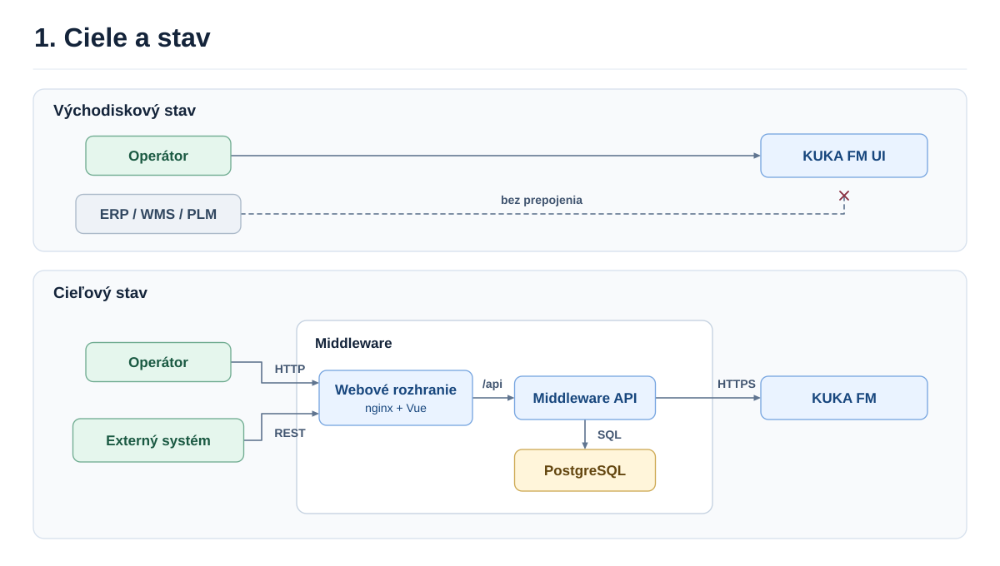

  

---

  

## 2. Požiadavky

  

### Funkcionálne požiadavky (FR)

  

| ID | Požiadavka |
|---|---|
| FR1 | Middleware umožní zadať (dispatch) novú misiu robotovi cez vlastný endpoint, ktorý interne zavolá `submitMission` na KUKA FM. |
| FR2 | Middleware umožní zrušiť (cancel) rozbehnutú misiu cez vlastný endpoint, ktorý interne zavolá `cancelMission` na KUKA FM. |
| FR3 | Middleware periodicky (pollingom) zisťuje aktuálny stav aktívnych misií cez Query jobs API KUKA FM a ukladá ho do vlastnej databázy. |
| FR4 | Middleware periodicky zisťuje aktuálny stav robotov (dostupný/zaneprázdnený/offline) cez príslušné query API KUKA FM a ukladá ho do vlastnej databázy. |
| FR5 | Middleware uchováva históriu stavov jednotlivých misií (nie len posledný stav) pre základné reportovanie. |
| FR6 | Middleware poskytuje webové rozhranie (frontend) so zoznamom misií a ich aktuálnym/historickým stavom. |
| FR7 | Middleware poskytuje webové rozhranie so zoznamom robotov a ich aktuálnym stavom. |

  

### Nefunkcionálne požiadavky (NFR)

  

| ID | Požiadavka |
|---|---|
| NFR1 | Middleware je kontajnerizovaný a používa perzistentnú databázu. |
| NFR2 | Vlastné API middlewaru je chránené — neautorizovaný/neplatný request je odmietnutý. |
| NFR3 | Middleware overuje platnosť KUKA FM `Authorization` tokenu pri každom volaní na KUKA FM (nutné od úplného začiatku vývoja, inak žiadne volanie nefunguje). |
| NFR4 | Middleware zapisuje štruktúrované logy o vlastnej činnosti a chybách. |
| NFR5 | Middleware je nasaditeľný cez CI/CD pipeline (build, test, statická analýza, redeploy). |

> **Realizácia:**
> - **NFR1, NFR2:** Docker Compose so štyrmi službami a pomenovanými zväzkami (volumes); API kľúč per klient v hlavičke `X-API-Key` (sekcia 9.1, 9.4).
> - **NFR3:** token KUKA FM sa podľa plnej príručky KUKA.AMR Fleet 2.15, kap. 4.7 generuje ručne vo webovom UI KUKA FM a middleware ho berie z konfigurácie `KukaFm:AccessToken` (voliteľný). Ak je nastavený, posiela sa v hlavičke `Authorization` pri každom volaní; KUKA FM odpovedá aj bez neho. Automatické vydanie a obnova tokenu nie sú možné, KUKA FM na to neposkytuje API (sekcia 9.2, 9.8).
> - **NFR4:** technické logy cez Serilog ako kompaktný JSON na stdout a do Seq; operácie používateľov do tabuľky `AuditLog` (sekcia 9.5).
> - **NFR5:** CI pipeline (build, statická analýza, unit testy) po úspešnom behu na `main` automaticky spustí CD pipeline (sekcia 9.6).

---

## 3. Prípady použitia (use-case diagram)

> Zadanie: diagram + krátky textový popis pre každý use case (aktér, cieľ, hlavný scenár) — správa misií (vrátane ukončených), správa robotov.

### Aktéri

| Aktér | Typ | Popis |
|---|---|---|
| Operátor | primárny (človek) | Pracuje s webovým UI middlewaru. |
| Externý systém | primárny (systém) | Fiktívny ERP/WMS, volá REST API middlewaru. |
| Plánovač (polling) | primárny (časovač) | Interná služba middlewaru, periodicky spúšťa synchronizáciu. |
| KUKA FM | sekundárny (systém) | Vykonáva misie, poskytuje stav misií a robotov. |

### 3.1 Správa misií *(FR1, FR2, FR5, FR6)*

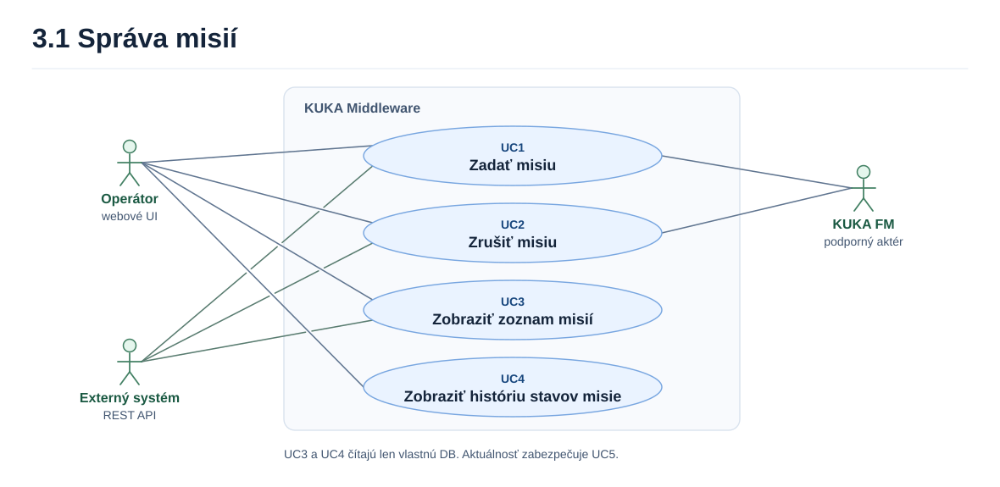

#### UC1 – Zadať misiu *(FR1)*

- **Aktér:** Operátor, Externý systém; sekundárny KUKA FM

- **Cieľ:** Odoslať novú misiu robotovi.

- **Hlavný scenár:**

  1. Aktér zadá parametre misie (typ, cieľové body, voliteľne robot).
  2. Middleware overí autorizáciu requestu a validuje vstup.
  3. Middleware uloží misiu v stave `Created` a pridá prvý záznam histórie.
  4. Middleware zavolá `submitMission` na KUKA FM. Po prijatí zapíše stav `Submitted` a záznam histórie.
  5. Aktér dostane ID misie.

- **Alternatívy:** neplatný vstup → 400; neautorizovaný → 401; KUKA FM odmietne/nedostupné → chyba sa zaloguje a vráti 502.

> **Realizácia:** aspoň 2 kroky, `ROLLER_MOVE` → 400 (Q19), pri chybe KUKA FM `Failed` + 502 s `missionId` – podrobnosti v sekcii 4.1 a 9.2.

#### UC2 – Zrušiť misiu *(FR2)*

- **Aktér:** Operátor, Externý systém; sekundárny KUKA FM

- **Cieľ:** Zastaviť rozbehnutú misiu.

- **Hlavný scenár:**

  1. Aktér vyberie zrušiteľnú misiu a zvolí *Zrušiť*.
  2. Middleware overí, že misia existuje a jej stav umožňuje zrušenie.
  3. Middleware zavolá `cancelMission` na KUKA FM.
  4. Po prijatí zrušenia middleware zapíše stav `Cancelling` aj do histórie. Stav `Cancelled` potvrdí synchronizácia.

- **Alternatívy:** nezrušiteľný stav → 409, misia neexistuje → 404.

> **Realizácia:** zrušenie vráti 200 a stav `Cancelling`, zrušiteľný je aj `Created`, súbežnosť stráži `xmin` – podrobnosti v sekcii 4.2 a 9.3.

#### UC3 – Zobraziť zoznam misií *(FR6)*

- **Aktér:** Operátor, Externý systém

- **Cieľ:** Prehľad prebiehajúcich aj ukončených misií s aktuálnym stavom.

- **Hlavný scenár:**

  1. Aktér otvorí zoznam misií (voliteľne filter aktívne / ukončené).
  2. Middleware vráti misie z vlastnej DB (nevolá KUKA FM).
  3. UI sa priebežne obnovuje (real-time aktualizácia).

#### UC4 – Zobraziť históriu stavov misie *(FR5, FR6)*

- **Aktér:** Operátor

- **Cieľ:** Vidieť časovú os zmien stavu konkrétnej misie.

- **Hlavný scenár:**

  1. Operátor v zozname misií otvorí detail misie.
  2. Middleware vráti záznamy histórie stavov zoradené podľa času.

### 3.2 Prehľad robotov *(FR7)*

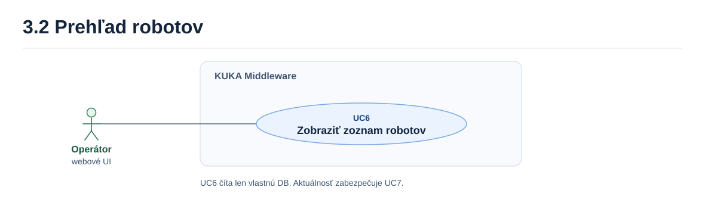

#### UC6 – Zobraziť zoznam robotov *(FR7)*

- **Aktér:** Operátor

- **Cieľ:** Prehľad robotov a ich aktuálneho stavu (dostupný / zaneprázdnený / offline).

- **Hlavný scenár:**

  1. Operátor otvorí obrazovku robotov.
  2. Middleware vráti roboty z DB, UI sa priebežne obnovuje.

### 3.3 Synchronizácia údajov s KUKA FM *(FR3, FR4, FR5)*

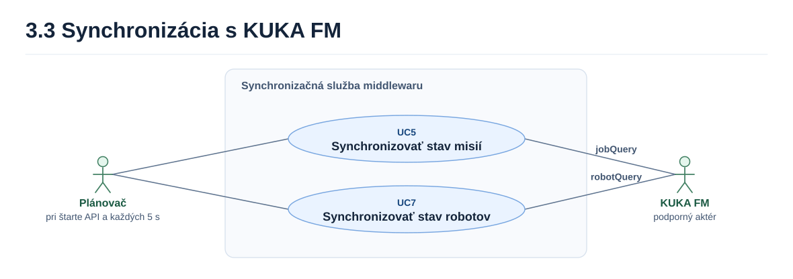

#### UC5 – Synchronizovať stav misií *(FR3, FR5)*

- **Aktér:** Plánovač; sekundárny KUKA FM

- **Cieľ:** Udržiavať stav aktívnych misií v DB aktuálny.

- **Hlavný scenár:**

  1. Plánovač v intervale (napr. 5 s) spustí synchronizáciu.
  2. Middleware zavolá Query jobs API KUKA FM pre aktívne misie.
  3. Pri zmene stavu aktualizuje misiu a pridá záznam do histórie.

- **Alternatívy:** KUKA FM nedostupné → zaloguje sa chyba, ďalší pokus v nasledujúcom cykle.

> **Realizácia:** synchronizácia beží hneď pri štarte API a potom každých 5 s (konfigurovateľné), pre každú aktívnu misiu volá `jobQuery`, zmeny ukladá jedným uložením za cyklus a záznamy histórie označí zdrojom `Sync`. Mapovanie stavov KUKA FM je v sekcii 5, detaily v sekcii 9.2.

#### UC7 – Synchronizovať stav robotov *(FR4)*

- **Aktér:** Plánovač; sekundárny KUKA FM

- **Cieľ:** Udržiavať stav robotov v DB aktuálny.

- **Hlavný scenár:**

  1. Plánovač v intervale spustí synchronizáciu.
  2. Middleware zavolá query API robotov na KUKA FM.
  3. Nové roboty vloží, existujúcim aktualizuje stav a čas poslednej aktualizácie.

> **Realizácia:** synchronizácia robotov (`robotQuery`) beží hneď pri štarte API a potom každých 5 s (konfigurovateľné). Pri neúspešnom volaní sa chyba zaloguje a dáta sa nemenia. Mapovanie stavov je v sekcii 5, detaily v sekcii 9.2.

---

  

## 4. Procesný diagram / diagram aktivít

> Zadanie: diagramy zachytávajú procesný tok pre jednotlivé prípady použitia.

### 4.0 Spoločný podproces – volanie KUKA FM s overením tokenu *(NFR3, NFR4)*

Každé volanie na KUKA FM (UC1, UC2, UC5, UC7) prechádza týmto podprocesom.

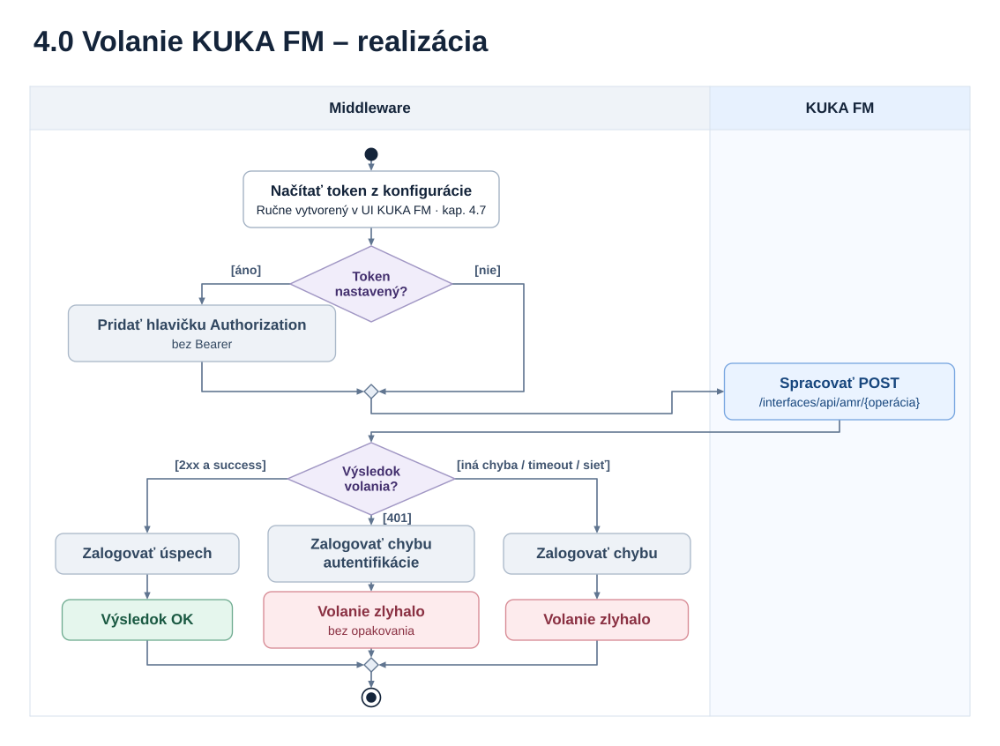

> **Realizácia (podľa plnej príručky KUKA.AMR Fleet 2.15, kap. 4.7):** access token sa generuje **ručne vo webovom UI KUKA FM** (Interface Platform → Authentication → „Generate an Access Token“), je viazaný na používateľský účet. Účet s priradeným tokenom ho môže zobraziť po overení hesla. Príručka neuvádza API na vydanie ani obnovu tokenu. Kroky cache a obnovy tokenu z návrhu preto nie sú uplatniteľné a middleware používa **token z konfigurácie** `KukaFm:AccessToken` (voliteľný). Ak je nastavený, posiela sa v hlavičke `Authorization` bez schémy (bez `Bearer`). Odpoveď **401 sa zaloguje ako chyba autentifikácie a volanie zlyhá bez opakovania** (UC1/UC2 → 502, synchronizácia → ďalší cyklus). Pri odpovedi 401 operátor overí token priradený k účtu v UI KUKA FM a skontroluje hodnotu v konfigurácii. V laboratóriu odpovedali jobQuery a robotQuery aj bez tokenu. Token sa nikdy nezapisuje do logov (sekcia 9.2).

### 4.1 UC1 – Zadať misiu

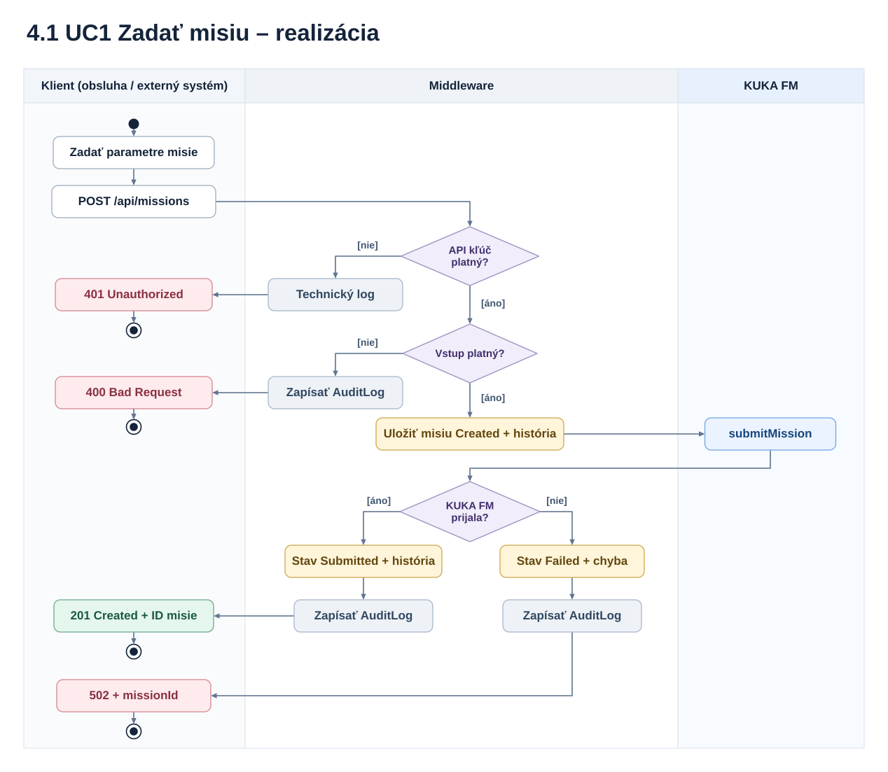

> **Realizácia:** misia sa najprv uloží ako `Created` s prvým záznamom histórie, potom sa zavolá `submitMission`. Úspech → `Submitted` a 201 s `id` a `missionCode`; odmietnutie alebo nedostupnosť KUKA FM → `Failed` a 502 s `missionId`. Validácia vyžaduje aspoň 2 kroky, `ROLLER_MOVE` vráti 400 (Q19). Každý pokus sa zapíše do `AuditLog`.

### 4.2 UC2 – Zrušiť misiu

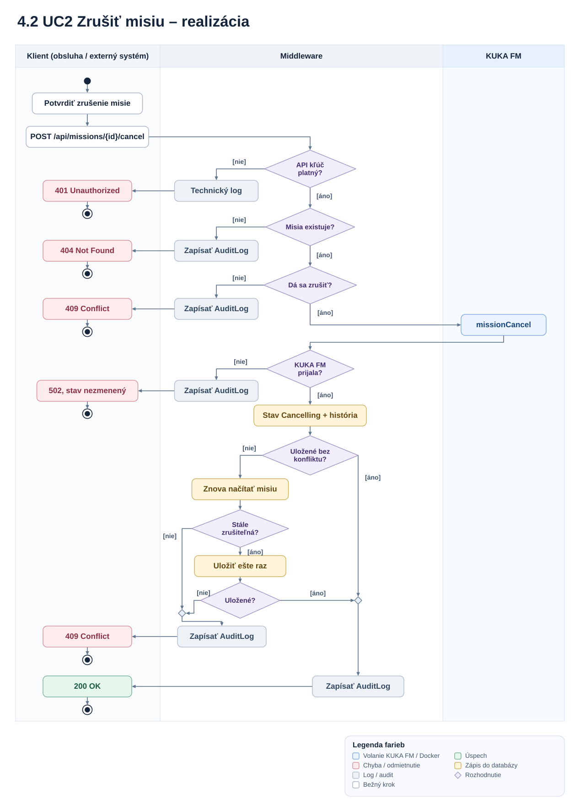

> **Realizácia:** úspešné zrušenie vracia **200** so súhrnom misie. Zrušiť sa dá aj misia v stave `Created`. Volá sa operácia KUKA FM `missionCancel` s režimom `FORCE`; chyba KUKA FM → 502. Pri konflikte verzie riadku `xmin`, ktorý spôsobil len zápis synchronizácie, sa uloženie stavu `Cancelling` po opätovnom načítaní raz zopakuje (KUKA FM sa znova nevolá); ak sa stav naozaj zmenil, vráti sa 409.
>
> Pozn.: finálny stav *Cancelled* potvrdí až synchronizácia (UC5), keď ho KUKA FM vráti.

### 4.3 UC3 / UC4 / UC6 – Zobrazenie misií, histórie a robotov

Čítanie ide výhradne z vlastnej DB, KUKA FM sa nevolá. Real-time aktualizácia je riešená periodickým obnovovaním UI.

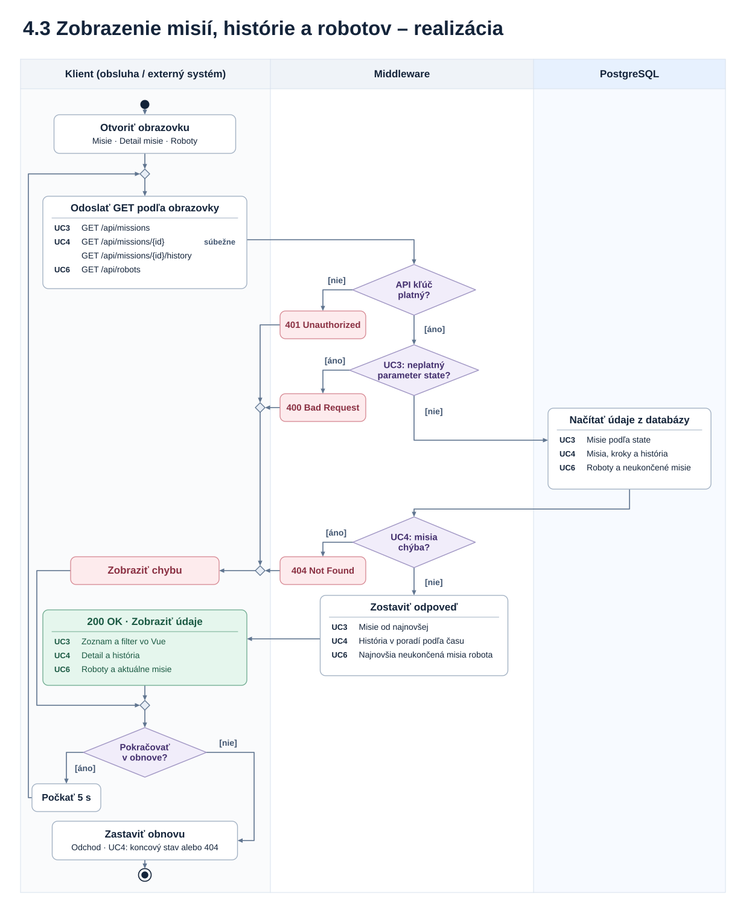

> **Realizácia:** webové UI načíta údaje hneď a ďalší cyklus spustí 5 s po dokončení predchádzajúceho. Pri UC4 sa detail a história načítajú súbežne. Automatická obnova detailu sa zastaví pri koncovom stave misie alebo pri odpovedi 404. Pri opustení obrazovky sa obnova zastaví a rozpracované požiadavky sa zrušia. Chýbajúci alebo neplatný API kľúč vráti 401. Pre webové UI kľúč dopĺňa nginx (sekcia 9.4).

### 4.4 UC5 – Synchronizovať stav misií

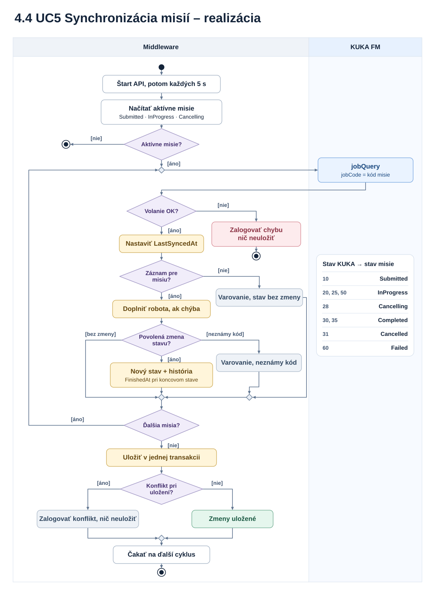

> **Realizácia:** hneď pri štarte API a potom každých 5 s sa načítajú aktívne misie (`Submitted`, `InProgress`, `Cancelling`) a pre **každú misiu** sa zavolá `jobQuery`. Kód stavu jobu sa namapuje podľa tabuľky v sekcii 5; pri zmene sa aktualizuje `Status`, pridá záznam histórie so zdrojom (`Source`) **`Sync`** a koncový stav nastaví `FinishedAt`. Misia bez robota dostane `RobotId` z odpovede. Neznámy kód alebo nenájdený job → varovanie, stav sa nemení. Každá spracovaná misia dostane `LastSyncedAt`, všetko sa uloží jedným uložením za cyklus; konflikt `xmin` sa preskočí a skúsi v ďalšom cykle.

### 4.5 UC7 – Synchronizovať stav robotov

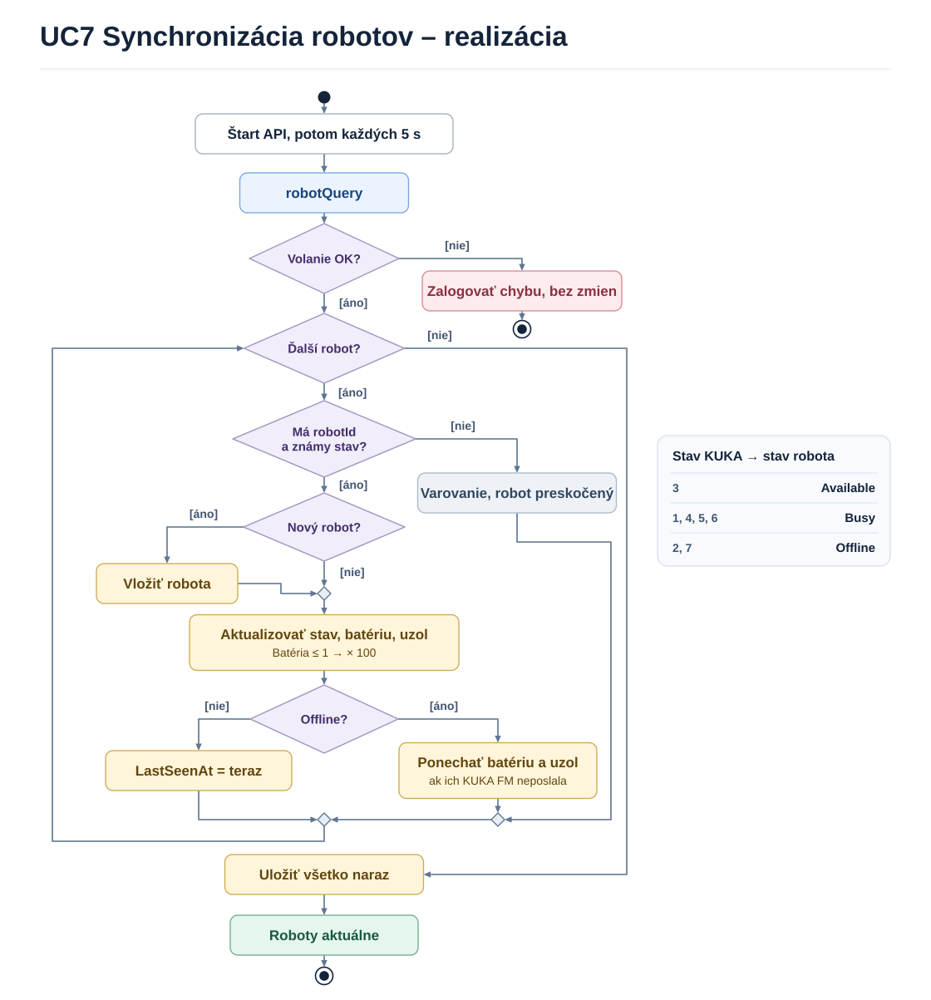

> **Realizácia:** stav robota sa mapuje len na `Available`, `Busy` a `Offline` (tabuľka v sekcii 5). Synchronizácia beží pri štarte API a potom každých 5 s. Neznámy stav → varovanie, riadok sa nemení; roboty, ktoré v odpovedi chýbajú, ostanú nezmenené. `LastSeenAt` sa nastaví len vtedy, keď robot nie je Offline; Offline robot si ponechá poslednú batériu a uzol.

---

## 5. Dátový model (ERD)

  

> Zadanie: entity, ktoré middleware ukladá vo vlastnej DB (napr. `Mission`, `Robot`, `StatusHistory`) a vzťahy medzi nimi.

  

### Rozhodnutia pre model

  

- **Autorizácia:** API kľúč per klient (`ApiClient`) — jeden kľúč pre web UI operátora, jeden pre externý systém. Ak sa neskôr zavedie prihlasovanie operátorov, `ApiClient` sa nahradí / doplní entitou `User` a FK v `Mission` a `AuditLog` sa presmerujú.

- **Audit vs. technické logy:** operácie používateľa (zadanie, zrušenie misie) sa ukladajú do tabuľky `AuditLog` (akceptačné kritérium *„všetky operácie vykonané používateľom sú logované"*). Technické štruktúrované logy (NFR4) idú na stdout / log sink, nie do DB.

- **História stavov:** len pre misie (FR5). História robotov nie je požadovaná, ukladá sa iba aktuálny stav (FR4).

  

### Diagram

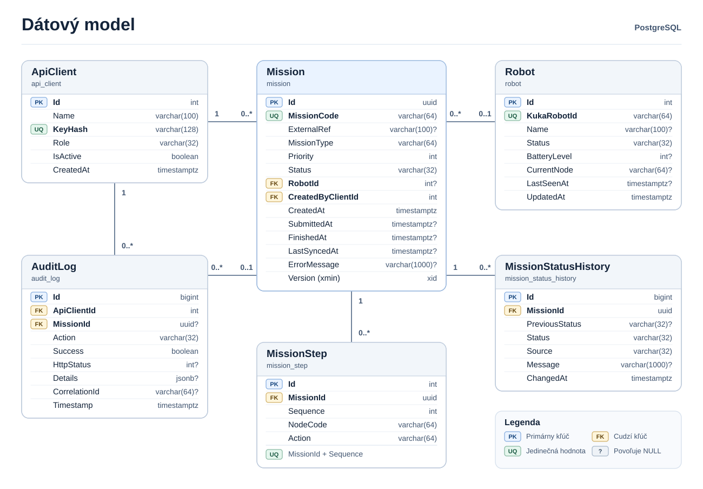

Kardinality v diagrame vyjadrujú väzby v PostgreSQL. Pri vytvorení misie aplikácia vyžaduje aspoň dva kroky a uloží prvý záznam histórie.

### Popis entít

  

| Entita | Účel | Plnená z | Požiadavka |
|---|---|---|---|
| `ApiClient` | Klient oprávnený volať API middlewaru. Ukladá sa len hash kľúča. | seed / admin | NFR2 |
| `Robot` | Aktuálny stav robota. | UC7 (polling KUKA FM) | FR4, FR7 |
| `Mission` | Misia a jej posledný známy stav. | UC1, UC2, UC5 | FR1, FR2, FR3, FR6 |
| `MissionStep` | Poradie cieľových bodov a akcií misie. | UC1 | FR1 |
| `MissionStatusHistory` | Každá zmena stavu misie (append-only). | UC1, UC2, UC5 | FR5, FR6 |
| `AuditLog` | Operácie vykonané klientom vrátane neúspešných. | UC1, UC2 | akceptačné kritérium |

### Stavy misie

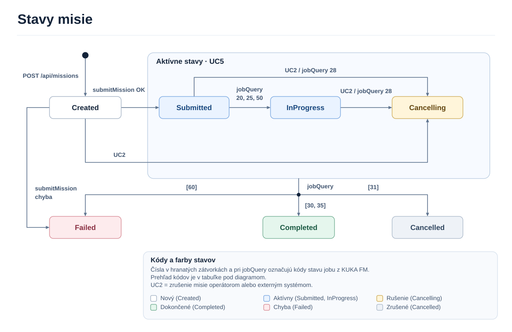

- **Aktívne stavy (UC5):** kruhy s prstencom označujú ukončenie zloženého stavu po prijatí koncového kódu z `jobQuery`. Platí to pre `Submitted`, `InProgress` aj `Cancelling`.
- **Koncové stavy:** prechod z rámca podľa prijatého kódu určí `Completed`, `Cancelled` alebo `Failed`. Pri vstupe do výsledného stavu sa nastaví `FinishedAt`.
- **Zrušiteľné stavy (UC2):** `Created`, `Submitted` a `InProgress`. Po prijatí `missionCancel` prejdú do `Cancelling`. Žiadosť o zrušenie v stave `Cancelling` alebo v koncovom stave vráti 409.

#### Mapovanie stavu jobu KUKA FM (`jobQuery`) → stav misie

| Kód stavu jobu KUKA FM | Stav misie |
|---|---|
| 10 | `Submitted`, aktuálny stav sa nemení |
| 20, 25, 50 | `InProgress` |
| 28 | `Cancelling` |
| 30, 35 | `Completed` |
| 31 | `Cancelled` |
| 60 | `Failed` |
| neznámy kód / job nenájdený | varovanie v logu, stav sa nemení, nastaví sa `LastSyncedAt` |

#### Mapovanie stavu robota KUKA FM (`robotQuery`) → stav robota

| Kód stavu robota KUKA FM | Stav robota |
|---|---|
| 3 | `Available` |
| 1, 4, 5, 6 | `Busy` |
| 2, 7 | `Offline` |
| neznámy kód | varovanie v logu, riadok sa nemení |

- **Batéria:** hodnota ≤ 1 sa číta ako podiel (napr. `1.0` = 100 %), väčšia ako percentá; výsledok sa oreže na 0–100. Mierku treba ešte overiť na robotovi, ktorý nie je nabitý (sekcia 9.9).
- `Name` robota ostáva prázdne (KUKA FM ho neposiela), `LastSeenAt` sa nastaví len vtedy, keď robot nie je `Offline`.

  

### Indexy a obmedzenia

  

| Tabuľka | Index / obmedzenie | Dôvod |
|---|---|---|
| `Mission` | `UNIQUE (MissionCode)` | párovanie s KUKA FM |
| `Mission` | `(Status)` | UC5 vyberá aktívne misie, UI filtruje aktívne/ukončené |
| `Mission` | `(CreatedAt DESC)` | zoznam misií v UI |
| `MissionStatusHistory` | `(MissionId, ChangedAt)` | časová os misie (UC4) |
| `Robot` | `UNIQUE (KukaRobotId)` | upsert pri synchronizácii (UC7) |
| `ApiClient` | `UNIQUE (KeyHash)` | vyhľadanie klienta pri autorizácii |
| `AuditLog` | `(Timestamp DESC)`, `(MissionId)` | prehľad operácií |
| `MissionStep` | `UNIQUE (MissionId, Sequence)` | bez duplicitného poradia krokov (doplnené pri realizácii) |

  

Enum hodnoty (`Status`, `Role`, `Action`, …) sa v EF Core ukladajú ako `string` (`HasConversion<string>()`) kvôli čitateľnosti v DB.

> **Realizácia:**
> - Fyzické názvy tabuliek a stĺpcov v PostgreSQL sú v **snake_case** (napr. `mission_status_history.changed_at`), entity v C# ostávajú v PascalCase.
> - `Mission` má verziu riadku PostgreSQL **`xmin`** na optimistickú kontrolu súbežnosti (zrušenie vs. synchronizácia).
> - Časy sú `timestamptz` v UTC; schéma vzniká EF Core migráciami pri štarte API.
> - Technické logy idú na stdout (kompaktný JSON) a do Seq, nie do DB (sekcia 9.5).

  

---

  

## 6. Návrh view aplikácie

  

> Zadanie: wireframe/mockup webového rozhrania — obrazovka pre manažment misií, obrazovka so zoznamom misií a ich stavom, obrazovka so zoznamom robotov a ich stavom. Stačí jednoduchý návrh, nie hotový grafický dizajn.

> **Realizácia – spoločné pre všetky obrazovky:** obrazovky zachovávajú vizuálny jazyk mockupov (horná lišta, ľavá navigácia, tabuľky a karty, stavové štítky, ukazovatele batérie). **UI je v angličtine** (texty z mockupov sú preložené), funguje vo **svetlej aj tmavej téme**, na šírke 375 px aj na desktope a len s klávesnicou. Údaje sa obnovujú každých 5 s (indikátor „Live · refresh 5 s“ v hlavičke). Navigácia nemá položku *Audit log* a hlavička zatiaľ nezobrazuje stav KUKA FM ani čas synchronizácie (rozhodnutie Q-J). Chyby (400, 401, 404, 409, 502) sa zobrazujú zrozumiteľným textom.

### 6.1 Zoznam misií

> **Realizácia (UC3):** tabuľka misií od najnovšej so stavovými štítkami. Filter **Active / Finished** je cez záložky s počtami, ktoré sa rátajú z jedného volania `GET /api/missions`. Ďalšie filtre, hľadanie a stránkovanie z mockupu nie sú v rozsahu (Q-G). Kliknutím na misiu sa otvorí jej detail.

### 6.2 Nová misia

> **Realizácia (UC1):** formulár s typom misie, prioritou 1–3 (predvolene 2), voliteľným externým kódom a krokmi. Formulár začína s **2 krokmi** a menej ako 2 kroky nedovolí (KUKA FM menej neprijme); poradie krokov sa mení tlačidlami posunu hore / dole. Výber robota ponúka „Automatic (KUKA FM decides)“ a roboty s ich stavom, Offline roboty sú neaktívne. Chyby validácie sa zobrazia pri príslušnom poli. `ROLLER_MOVE` formulár ponúka, ale API ho zatiaľ odmietne s 400 (Q19).

### 6.3 Detail misie

> **Realizácia (UC4):** údaje misie (kód, typ, priorita, robot alebo „Automatic (KUKA FM decides)“, časy, chyba), karta **Mission steps** a časová os **Status history** so všetkými zmenami stavu zoradenými podľa času aj so zdrojom zmeny (API alebo synchronizácia). Detail a história sa načítajú súbežne; obnova sa zastaví pri koncovom stave misie alebo pri 404. Tlačidlo zrušenia sa zobrazí len pri zrušiteľnej misii.

### 6.4 Zrušenie misie

> **Realizácia (UC2):** potvrdzovacie dialógové okno „Cancel mission M-…?“ vysvetlí, že misia prejde do stavu `Cancelling` a stav `Cancelled` potvrdí až KUKA FM. Po potvrdení sa zavolá `POST /api/missions/{id}/cancel`; chyba (napr. 404, 409, 502) sa zobrazí priamo v okne.

### 6.5 Roboty

> **Realizácia (UC6):** štyri dlaždice (Total / Available / Busy / Offline), hľadanie podľa názvu alebo KUKA ID, filter stavu a prepínač zobrazenia **karty / tabuľka** – všetko na klientovi z jedného volania `GET /api/robots` (rozhodnutie Q-S). Karta robota ukazuje stav, batériu, aktuálny uzol a aktuálnu misiu s odkazom na jej detail; Offline robot ukazuje čas, kedy bol naposledy videný.

---

  

## 7. Technológie

  

Použité technológie pri vývoji middlewaru, napr.:

  

- **Backend:** ASP.NET Core minimal API (C#), Entity Framework Core

- **DB:** PostgreSQL

- **Frontend:** Vue3 Framework

- **Kontajnerizácia:** Docker + docker-compose

> **Realizácia – použitý stack:**
>
> | Oblasť | Technológia |
> |---|---|
> | Backend | .NET 10 (SDK 10.0.402), ASP.NET Core minimal API, C# |
> | ORM / DB | EF Core 10 + Npgsql (`Npgsql.EntityFrameworkCore.PostgreSQL` 10.0.3, `EFCore.NamingConventions`), PostgreSQL 18 (`postgres:18.6-alpine`) |
> | Úlohy na pozadí | `BackgroundService` s `PeriodicTimer` (synchronizácia robotov a misií) |
> | Frontend | Vue 3.5 + Vue Router 5, Vite 8, TypeScript (strict); stav v composables, čisté scoped CSS s tokenmi z `DESIGN.md` |
> | Web server | nginx 1.30 (servuje SPA, proxy `/api`) |
> | Logovanie | Serilog (`Serilog.AspNetCore`, `Serilog.Sinks.Seq`) + Seq (`datalust/seq`) |
> | Testy | backend xUnit v3 + NSubstitute; frontend Vitest |
> | Kontajnery | Docker Compose (Docker Desktop), služby `web`, `api`, `postgres`, `seq` |
> | CI/CD | Azure Pipelines (YAML) na vlastnom Windows agentovi |

  

---

  

## 8. Akceptačné kritériá

  

- [x] Je možné zadať novú misiu.

- [x] Je možné zrušiť prebiehajúcu misiu.

- [x] Je možné prezrieť stav prebiehajúcich misií, ktoré sa aktualizujú v reálnom čase, a ukončených misií.

- [x] Je možné prezrieť stav robotov, ktoré sa aktualizujú v reálnom čase.

- [x] Prístup ku KUKA FM API volaniu je zabezpečený access tokenom. *(token z konfigurácie podľa plnej príručky KUKA.AMR Fleet 2.15, kap. 4.7; vydanie a obnova tokenu cez API nie sú v KUKA FM možné)*

- [x] Všetky operácie vykonané používateľom sú logované.

- [x] Proces testovania a nasadenia je plne automatizovaný využitím CI/CD pipeline. *(CI → CD beží automaticky; ruleset na GitHube vyžaduje PR a úspešnú kontrolu `kuka-middleware-ci`)*

> **Realizácia:** vyhodnotenie k 26. 11. 2026 s dôkazmi pre Epic aj každú User Story je v sekcii 9.8.

  

---

  

## 9. Realizácia a stav implementácie

  

> Stav k 26. 11. 2026. Sekcia opisuje, ako bol návrh zo sekcií 1–8 realizovaný, a uvádza odchýlky a otvorené body. Podrobný priebeh po fázach je v `implementation.md` a v poznámkach v `history/` (v angličtine).

  

### 9.1 Architektúra a nasadenie

  

Riešenie beží výhradne v **Docker Compose** (projekt `kuka-middleware`) so štyrmi službami:

| Služba | Úloha | Port na hostiteľovi |
|---|---|---|
| `web` | nginx so zostavenou Vue aplikáciou, proxy `/api` na `api`, dopĺňa API kľúč web UI | `127.0.0.1:8080` (lokálne, `WEB_PORT`) |
| `api` | ASP.NET Core minimal API, EF Core migrácie pri štarte, synchronizácia robotov a misií na pozadí | nepublikovaný |
| `postgres` | PostgreSQL 18, pomenovaný volume `pgdata` (dáta prežijú reštart aj `down` / `up`) | nepublikovaný |
| `seq` | Seq – prehliadač štruktúrovaných logov, volume `seq-data` | `127.0.0.1:5341` |

- API sa ku KUKA FM (`https://kukafm.its.fei`, IP 147.175.126.137) pripája len cez **školskú VPN**. Kontajnery nepoužívajú súbor hosts Windowsu, preto compose mapuje meno cez `extra_hosts` (premenná `KUKA_FM_IP`). Verejný self-signed certifikát KUKA FM (`docker/certs/kukafm.crt`, CN=its.fei, SAN `*.its.fei`) je dôveryhodný v image `api`.
- Bez VPN aplikácia naštartuje, ale zadanie a zrušenie misie vrátia 502 a synchronizácia loguje varovania v každom cykle.
- Lokálne sa stack spúšťa príkazom `docker compose -f docker/docker-compose.yml up -d --build`; nasadenie cez CD používa ten istý compose projekt a volume (sekcia 9.6).

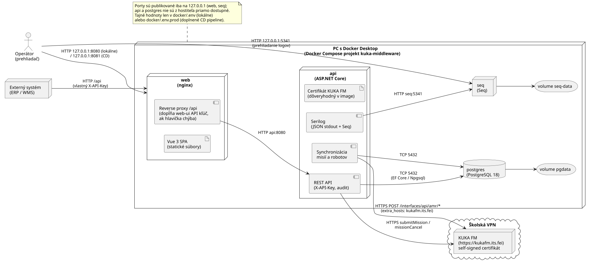

  

### 9.2 Integrácia s KUKA FM

  

Všetky volania idú cez **jedného typovaného klienta** (`IKukaClient`) podľa dokumentácie *KUKA.AMR Fleet 2.15*, kap. 7. Každá operácia KUKA FM je `POST` pod `/interfaces/api/amr/`:

| Logická operácia | Endpoint KUKA FM | Použitie |
|---|---|---|
| `submitMission` | `POST /interfaces/api/amr/submitMission` | UC1 – zadanie misie |
| `cancelMission` | `POST /interfaces/api/amr/missionCancel` | UC2 – zrušenie misie |
| Query jobs | `POST /interfaces/api/amr/jobQuery` | UC5 – synchronizácia misií (pre každú aktívnu misiu) |
| Query robotov | `POST /interfaces/api/amr/robotQuery` | UC7 – synchronizácia robotov |

- **Autorizácia:** podľa plnej príručky KUKA.AMR Fleet 2.15, kap. 4.7 sa access token generuje ručne vo webovom UI KUKA FM (Interface Platform → Authentication, str. 135–136). Pri účte s priradeným tokenom sa token zobrazí po overení hesla. Príručka neuvádza API na jeho vydanie ani obnovu. Voliteľný token z konfigurácie `KukaFm:AccessToken` sa posiela ako `Authorization: <token>` **bez schémy** (bez `Bearer`). 401 sa zaloguje ako chyba autentifikácie a volanie zlyhá bez opakovania; operátor overí token v UI KUKA FM a skontroluje hodnotu v konfigurácii. Token sa nikdy neloguje.
- **Mapovanie misie:** typ `RACK_MOVE` – krok `Load` → `UP_CONTAINER`, `Unload` → `DOWN_CONTAINER`, `Wait` → krok bez akcie s kontajnerom, `passStrategy` AUTO a `waitingMillis` 5000 (`KukaFm:WaitMillis`); typ kroku `NODE_POINT`; priorita 1–3 sa posiela bez zmeny. Typ `ROLLER_MOVE` vyžaduje `binCode` pre každý krok, ktorý API nemá, preto ho API odmieta s 400 (Q19).
- **Kódy:** `missionCode` pre KUKA FM = náš `MissionCode` vo formáte `M-yyyy-NNNN` (číslo z PostgreSQL sekvencie); `requestId` je nový 32-znakový hex GUID pre každé volanie; `orgId` je `UNIVERSAL` a režim zrušenia `cancelMode` je `FORCE` (oboje z konfigurácie).
- **Synchronizácia:** obe synchronizácie (roboty aj aktívne misie) bežia hneď pri štarte API a potom každých 5 s (`Sync:RobotIntervalSeconds`, `Sync:MissionIntervalSeconds`). Zadanie misie nečaká na prvú synchronizáciu. Mapovanie stavov je v sekcii 5.
- **Logovanie:** úspešné volania na úrovni Debug, neúspešné ako Warning / Error.
- **Živý test 26. 11. 2026** (školská VPN, bez tokenu):
  - synchronizácia robotov vložila 3 roboty (stav 3 → `Available`, batéria `1.0` → 100 %);
  - misia **M-2026-0039** (robot 1, 2 kroky `Wait`) prešla `Created` → `Submitted` → `InProgress` (job 20) → `Cancelling` → `Cancelled` (job 31);
  - misia s jedným krokom bola v KUKA FM odmietnutá („missionData length is less than 2") → `Failed` + 502 s `missionId`; preto API aj UI vyžadujú aspoň 2 kroky a 1-krokový request teraz vráti 400;
  - KUKA FM prijalo všetky štyri volania aj bez tokenu, preto je token všade voliteľný.

  

### 9.3 REST API middlewaru

  

Základná cesta `/api`, JSON (camelCase), chyby ako RFC 7807 ProblemDetails. Každý endpoint okrem `/api/health` vyžaduje platný API kľúč.

| Metóda | Cesta | Účel | Odpovede |
|---|---|---|---|
| POST | `/api/missions` | Zadanie misie (UC1) | 201 + `id`, `missionCode`; 400, 401, 502 (s `missionId` neúspešnej misie) |
| POST | `/api/missions/{id}/cancel` | Zrušenie misie (UC2) | 200 + súhrn misie; 401, 404, 409, 502 |
| GET | `/api/missions?state=active\|finished` | Zoznam misií (UC3), bez `state` = všetky | 200, 401 (neplatný `state` → 400) |
| GET | `/api/missions/{id}` | Detail misie s krokmi (UC4) | 200, 401, 404 |
| GET | `/api/missions/{id}/history` | História stavov zoradená podľa času (UC4) | 200, 401, 404 |
| GET | `/api/robots` | Roboty so stavom a aktuálnou misiou (UC6) | 200, 401 |
| GET | `/api/health` | Kontrola dostupnosti po nasadení | 200 |

- Vstup `POST /api/missions`: `missionType` (`RACK_MOVE` \| `ROLLER_MOVE`), `priority` 1–3 (predvolene 2), voliteľne `robotId` (musí existovať) a `externalRef` (≤ 100 znakov), `steps[]` aspoň 2 s `nodeCode` (1–64 znakov) a `action` (`Load` \| `Unload` \| `Wait`).
- Filter `active` vráti všetky nekoncové misie (aj `Created`), `finished` koncové.

  

### 9.4 Bezpečnosť

  

- **API kľúč per klient** v hlavičke `X-API-Key`: jeden pre web UI (`web-ui`), jeden pre externý systém. Kľúče sú náhodné 32-bajtové hex hodnoty; v DB sa ukladá len ich **SHA-256 hash**. Request bez platného kľúča dostane 401. Autentifikovaný klient je vlastníkom misie, ktorú vytvorí.
- **nginx dopĺňa kľúč web UI**, ak request nemá vlastnú hlavičku; explicitná hlavička (externý systém) sa posiela ďalej bez zmeny, takže neplatné kľúče sú odmietnuté. Kľúč nie je v zostavenom frontende ani v image.
- Web (`8080`) aj Seq (`5341`) sú publikované **len na `127.0.0.1`**; PostgreSQL a API nie sú publikované vôbec. Prístup k lokálnemu UI teda autorizuje operácie ako `web-ui` (jednotliví operátori sa nerozlišujú).
- **Tajomstvá** (heslo DB, API kľúče, voliteľný token KUKA FM) sú len v lokálnom súbore `docker/.env` (necommituje sa, v repozitári je iba `docker/.env.example` s placeholdermi) a v **tajných premenných pipeline** CD. Nikdy nie sú v appsettings, v image ani v logoch.

  

### 9.5 Logovanie a monitoring

  

- **Technické logy (NFR4):** Serilog zapisuje kompaktný JSON na stdout a tie isté udalosti do **Seq** (`http://seq:5341` v rámci compose, UI na **http://localhost:5341**, len lokálne, bez prihlásenia). Logy SQL príkazov EF Core a `System.Net.Http` sú na úrovni Warning.
- **Audit operácií:** každé zadanie a zrušenie misie, aj neúspešné (neplatný vstup, 404, 409, 502), sa zapíše do tabuľky `AuditLog` s akciou, klientom, výsledným HTTP stavom, príznakom úspechu, časom v UTC a correlation ID. Anonymné pokusy s 401 idú len do technických logov. Čítacie endpointy a health check audit nevytvárajú.
- **Nikdy sa nelogujú** API kľúče, token KUKA FM, hodnoty hlavičiek ani telá requestov.

  

### 9.6 CI/CD

  

Pipelines v Azure DevOps (YAML v `ci-cd/`) bežia na **vlastnom Windows agentovi** tímu (Windows PowerShell 5.1).

- **`kuka-middleware-ci`** (`ci-cd/ci.yml`) – pri každom pushi do ľubovoľnej vetvy a pri každom PR do `main`: backend (SDK z `backend/global.json`, Release build s .NET analyzátormi a warnings as errors, xUnit testy) a frontend (Node 24, `npm ci`, TypeScript, ESLint, Vitest, produkčný build). Výsledky testov sa publikujú do záložky Tests; akákoľvek chyba pipeline zastaví.
- **`kuka-middleware-cd`** (`ci-cd/cd.yml`) – spustí sa **automaticky po úspešnom behu CI na `main`** (overené: CI `#20261126.16` → CD `#20261126.3`) a nasadí presne ten commit, ktorý prešiel CI. Kroky: kontrola Docker Desktop, validácia premenných, zrkadlenie zdrojov do `DeployPath`, vyplnenie `docker/.env.prod` z premenných pipeline, `docker compose build` a `up -d` (rovnaký compose projekt a volume ako lokálny vývoj, nikdy `down -v`), **smoke test** webu, `/api/health` a Seq (HTTP 200, inak pipeline zlyhá), upratanie build cache.
- **Premenné pipeline CD:** `AgentPoolName`, `AgentName`, `WebPort`, `DeployPath`, `DbName`, `DbUser` a tajné `DbPassword`, `WebUiApiKey`, `ExternalSystemApiKey`, `KukaFmAccessToken` (voliteľný). Tajomstvá sú tajné premenné pipeline (nie variable group) a nikdy sa nevypisujú.
- **Ochrana vetvy `main`:** ruleset na GitHube vyžaduje pull request a úspešnú kontrolu `kuka-middleware-ci`, blokuje mazanie vetvy a force push (overené 26. 11. 2026).

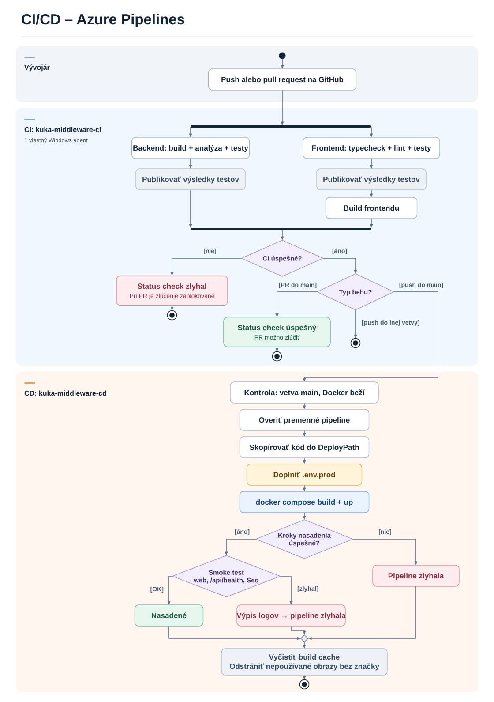

  

### 9.7 Testovanie

  

Stav k 26. 11. 2026: **322 backend** a **97 frontend** unit testov, všetky úspešné (lokálne aj v CI).

- **Backend** (xUnit v3 + NSubstitute, len unit testy, bez databázy):
  - validácia vstupu (hranice priority, krokov, `nodeCode`, `externalRef`, typy a akcie, minimum 2 kroky, `ROLLER_MOVE` → 400);
  - zadanie misie (`Submitted`, `Failed` + 502 s `missionId`, audit každého pokusu) a zrušenie (404, 409 pre každý koncový stav a `Cancelling`, chyba KUKA FM → 502, konflikt `xmin` s jedným opakovaním);
  - zoznam, filter aktívne / ukončené, detail a poradie histórie, 404; zoznam robotov a aktuálna misia;
  - klient KUKA FM (hlavička `Authorization` len pri nastavenom tokene, spracovanie odpovedí, nedostupnosť, 401 bez opakovania, token sa neloguje);
  - synchronizácia misií (každý kód stavu jobu, neskoré prechody, `FinishedAt`, `LastSyncedAt`, jedno uloženie za cyklus, chyba KUKA FM) a robotov (každý stav 1–7, nový / existujúci robot, batéria, `LastSeenAt`, chyba nemení dáta);
  - API kľúč (chýbajúci / neplatný / neaktívny → 401) a audit middleware.
- **Frontend** (Vitest, len composables a čisté funkcie): polling (štart / stop, bez prekrývania požiadaviek), validácia formulára novej misie (aspoň 2 kroky), mapovanie stavov misií a robotov na štítky, formátovanie a texty chýb ProblemDetails.
- **Živé overenie:** stack v Dockeri na http://localhost:8080 a živý test proti KUKA FM (sekcia 9.2).

  

### 9.8 Stav akceptačných kritérií

  

**Epic (sekcia 8):**

| Kritérium | Stav | Dôkaz / poznámka |
|---|---|---|
| Zadať novú misiu | splnené | `POST /api/missions` → `submitMission`, živý test M-2026-0039 |
| Zrušiť prebiehajúcu misiu | splnené | `missionCancel` → `Cancelling`, `Cancelled` potvrdené synchronizáciou |
| Prezrieť prebiehajúce (real-time) a ukončené misie | splnené | zoznam s filtrom, polling 5 s, synchronizácia misií každých 5 s |
| Prezrieť stav robotov v reálnom čase | splnené | obrazovka Roboty, polling 5 s, synchronizácia robotov každých 5 s |
| Prístup ku KUKA FM API zabezpečený access tokenom | splnené | token z konfigurácie v hlavičke `Authorization` podľa plnej príručky KUKA.AMR Fleet 2.15, kap. 4.7 (token sa generuje ručne v UI KUKA FM, API na obnovu neexistuje); KUKA FM odpovedá aj bez tokenu |
| Všetky operácie používateľa sú logované | splnené | `AuditLog` pre každé zadanie a zrušenie vrátane neúspešných |
| Testovanie a nasadenie automatizované CI/CD | splnené | CI → CD automaticky; ruleset na GitHube vyžaduje úspešné CI pred mergom |

**User Stories (backlog)** – tabuľka je zhodná s tabuľkou „Stav implementácie" v `backlog.md`. **splnené** = všetky akceptačné kritériá splnené (kritériá, ktoré podľa dokumentácie KUKA FM nie sú uplatniteľné, sú uvedené v poznámke) · **čiastočne** = chýba uvedený krok.

| US | Stav | Splnené | Odchýlka / otvorené |
|---|---|---|---|
| 1.1 UC1 – Zadať misiu | splnené | validácia (400, aspoň 2 kroky), API kľúč (401), `submitMission` → `Submitted` + história a ID, odmietnutie / nedostupnosť → `Failed` + 502 s `missionId`, audit každého pokusu; overené naživo | `ROLLER_MOVE` vráti 400, kým sa nerozhodne o `binCode` (Q19) |
| 1.2 UC2 – Zrušiť misiu | splnené | 404 / 409, potvrdenie v UI, `missionCancel` → `Cancelling` + história, chyba KUKA FM → 502, kontrola súbežnosti `xmin`, `Cancelled` zo synchronizácie; overené naživo | – |
| 1.3 UC3 – Zoznam misií | splnené | `GET /api/missions?state=active\|finished` z vlastnej DB, obrazovka s filtrom a obnovou každých 5 s, testy filtra | – |
| 1.4 UC4 – História stavov misie | splnené | detail a história zoradená podľa času, 404, obrazovka s časovou osou, testy | – |
| 2.1 UC6 – Zoznam robotov | splnené | `GET /api/robots` z vlastnej DB s aktuálnou misiou, obrazovka (dlaždice, hľadanie, filter, karty / tabuľka), obnova každých 5 s, testy | – |
| 3.1 Prístup ku KUKA FM API s access tokenom | splnené | jeden typovaný klient pre 4 volania, token z konfigurácie v hlavičke `Authorization` pri každom volaní (podľa plnej príručky KUKA.AMR Fleet 2.15, kap. 4.7), 401 sa zaloguje ako chyba autentifikácie a volanie zlyhá, logovanie volaní bez tokenu | kritériá cache a obnovy tokenu pri 401 nie sú uplatniteľné: token sa podľa kap. 4.7 generuje ručne vo webovom UI KUKA FM, API na vydanie ani obnovu neexistuje |
| 3.2 UC7 – Synchronizovať stav robotov | splnené | synchronizácia pri štarte a každých 5 s, mapovanie stavov 1–7, vloženie / aktualizácia, `LastSeenAt`, chyba nemení dáta; naživo 3 roboty | mierku batérie overiť na robotovi, ktorý nie je nabitý |
| 3.3 UC5 – Synchronizovať stav misií | splnené | aktívne misie každých 5 s cez `jobQuery`, mapovanie stavov, história, `FinishedAt`, `LastSyncedAt`, jedno uloženie za cyklus, opakovanie v ďalšom cykle; naživo `InProgress` a `Cancelled` | – |
| 4.1 Kontajnerizácia a databáza | splnené | `docker compose up` spustí web, api, postgres (a seq), schéma z EF Core migrácie pri štarte, dáta prežijú reštart | – |
| 4.2 Zabezpečenie API a logovanie | splnené | API kľúč + 401, len hashe kľúčov, štruktúrované JSON logy na stdout aj do Seq, `AuditLog` pre každé zadanie a zrušenie | – |
| 4.3 CI pipeline | splnené | `kuka-middleware-ci`: build backendu aj frontendu, statická analýza, unit testy, publikované výsledky; zlyhá pri chybe; ruleset na GitHube vyžaduje úspešné CI pred mergom do `main` | – |
| 4.4 CD pipeline | splnené | `kuka-middleware-cd` sa spustí automaticky po úspešnom CI na `main`, `docker compose build` + `up -d`, smoke test webu, `/api/health` a Seq | tajomstvá ako tajné premenné pipeline namiesto variable group |

  

### 9.9 Otvorené body

  

| # | Bod |
|---|---|
| Q10 | Spevnenie kontajnerov: nginx ako non-root a healthcheck pre `api` v compose. |
| Q12 | Zoradenie robotov podľa mena rozlišuje veľké a malé písmená – zmeniť? |
| Q13 | Ak robot vybraný vo formulári Nová misia prejde do Offline, formulár upozorní, ale misiu odošle – blokovať? |
| Q14 | Mobilná navigácia sa pri prechode cez 768 px viditeľne vysunie – potlačiť prechod pri zmene šírky? |
| Q15 | `.impeccable/design.json` je starší ako `DESIGN.md` – zosynchronizovať. |
| Q16 | Keď kontajner `api` nebeží, nginx vráti vlastnú HTML 502 a UI hlási „KUKA FM did not respond" – rozlíšiť „API nedostupné". |
| Q19 | `ROLLER_MOVE` vyžaduje `binCode` KUKA FM pre každý krok; API ho odmieta s 400, UI ho stále ponúka – doplniť do kontraktu, konfigurovať, alebo skryť v UI? |
| Q20 | UI zobrazuje každú 502 ako „KUKA FM did not respond" – zobraziť dôvod odmietnutia z KUKA FM a odkaz na neúspešnú misiu cez `missionId`. |
| – | Mierka batérie (podiel vs. percentá) – overiť na robotovi, ktorý nie je plne nabitý. |
| – | Token KUKA FM a cesta pri 401 neboli overené naživo (token zatiaľ nie je nastavený v konfigurácii, KUKA FM ho nevyžaduje) – vygenerovať token v UI KUKA FM, nastaviť `KukaFm:AccessToken` a overiť. |
| – | Stav KUKA FM a čas synchronizácie v hlavičke UI (Q-J) sú odložené. |
